# APIBrasil MCP Client



  

**🌐 Language:** **English** · [Português](./README.md)

Knowledge base, configurations and guides for consuming the APIBrasil **MCP** server from **AI clients**, **IDEs**, **chatbots** and **automation tools**.

> **Note:** [APIBrasil](https://apibrasil.io) is a unified API gateway for Brazilian data (postal codes, company registry, vehicles, etc). This repository focuses on integrating those APIs through the **MCP protocol** for AI agents.

---

## Quick decision (TL;DR)

Pick the connection method based on your platform:

| Trait | MCP Protocol | REST API |
| :--- | :--- | :--- |
| **Protocol** | Streamable HTTP (streaming) | HTTP Standard |
| **State** | **Stateful** (persistent session) | **Stateless** (request/response) |
| **Best for** | Cursor, Claude, AI agents | n8n, Typebot, Zapier, Webhooks |
| **Upside** | Continuous context for LLMs | Universal simplicity |

## Endpoints

| Service | URL |
| :--- | :--- |
| **MCP Server** | `https://mcp.apibrasil.cloud/mcp` |
| **API Gateway** | `https://gateway.apibrasil.io/api/v2` |
| **Docs** | [doc.apibrasil.io](https://doc.apibrasil.io) |

## Connecting (copy & paste)

Most clients only speak **stdio**, so we use the official [`mcp-remote`](https://www.npmjs.com/package/mcp-remote) bridge, which converts stdio ⇆ **Streamable HTTP** and injects credentials via header:

```json
{
  "mcpServers": {
    "apibrasil": {
      "command": "npx",
      "args": [
        "-y",
        "mcp-remote",
        "https://mcp.apibrasil.cloud/mcp",
        "--header",
        "X-Apibrasil-Bearer:${APIBRASIL_BEARER}",
        "--header",
        "DeviceToken:${APIBRASIL_DEVICE_TOKEN}"
      ],
      "env": {
        "APIBRASIL_BEARER": "YOUR_BEARER_TOKEN",
        "APIBRASIL_DEVICE_TOKEN": "YOUR_DEVICE_TOKEN"
      }
    }
  }
}
```

### CLI one-liner

```bash
npx -y mcp-remote https://mcp.apibrasil.cloud/mcp \
  --header "X-Apibrasil-Bearer:YOUR_BEARER_TOKEN" \
  --header "DeviceToken:YOUR_DEVICE_TOKEN"
```

> [!IMPORTANT]
> **Security & state**
> - **Stateful:** MCP keeps a live session (`Mcp-Session-Id`) via Streamable HTTP. Don't use it in environments that kill the connection immediately (pure serverless without streaming).
> - **Tokens:** never commit real tokens. Use environment variables or secret managers.

## Where to go next

| Goal | Directory |
| :--- | :--- |
| **Connect an AI client** | [`clientes-ai/`](./clientes-ai/) — Claude Desktop, LibreChat, Lovable |
| **Configure an IDE** | [`ide-editores/`](./ide-editores/) — VS Code, Cursor, Zed, JetBrains |
| **Build a chatbot** | [`chatbots-ai/`](./chatbots-ai/) — Typebot, Flowise, LangFlow, Dify |
| **Automation** | [`lowcode-automacao/`](./lowcode-automacao/) — n8n, Make, Zapier, Bubble |
| **Programming** | [`programacao/`](./programacao/) — Python, Node.js, Go, Java, C# |
| **Understand MCP** | [`conceitos/`](./conceitos/) — credentials, discovery, troubleshooting |

## Concepts

- **[Credentials](./conceitos/credenciais/)** — how to pass `bearer` / `DeviceToken` / `SecretKey` (header or argument).
- **[Dynamic discovery](./conceitos/descoberta/)** — `apibrasil_catalog` → `apibrasil_describe` → `apibrasil_call`.
- **[Troubleshooting](./conceitos/troubleshooting/)** — gateway errors (402/403/410/422) and session issues.

## Contributing

See the [contribution guide](./CONTRIBUTING.md) (Portuguese). Keep the auto-generated index in sync:

```bash
python scripts/update_readme_tree.py
```

> The detailed per-tool docs are currently in Portuguese. Contributions translating them are welcome.
